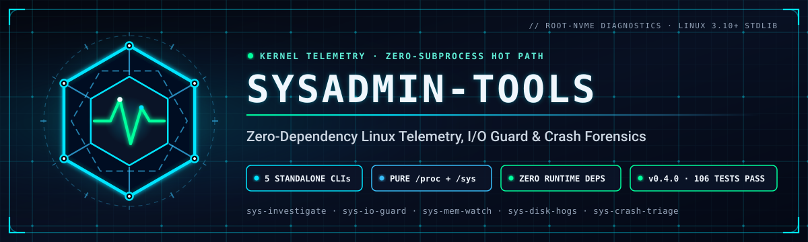
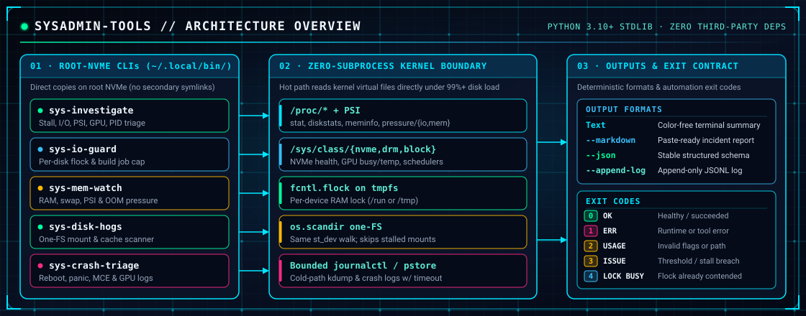
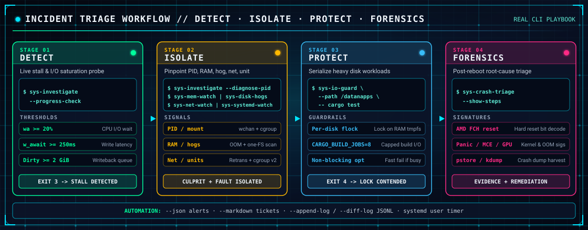

<div align="center">

<a href="docs/README.md">
  
</a>

<br />


**Zero-dependency Linux sysadmin investigation, I/O serialization, memory/disk auditing, and post-crash forensics CLIs — engineered to stay responsive when disks are 99%+ saturated.**

[Documentation Hub](docs/README.md) · [User's Guide](docs/user-guide/README.md) · [Architecture](docs/architecture.md) · [Running & CLI Reference](docs/running.md) · [How-To Recipes](docs/how-to.md) · [Diagrams](docs/diagrams/README.md) · [Changelog](CHANGELOG.md)

</div>

---

## Tool Suite

All five CLIs are **100% self-contained Python 3.10+ standard-library scripts** installed as direct file copies into `~/.local/bin` on your root NVMe (never symlinks to secondary mounts), reading `/proc` and `/sys` directly without shelling out on hot diagnostic paths.

| Icon | CLI | Purpose | User's Guide |
| :---: | :--- | :--- | :--- |
|  | **`sys-investigate`** | Live two-snapshot CPU/load/PSI/disk/NVMe-thermal investigator, productivity classifier, mount & cgroup attribution, `--progress-check`, and `--diagnose-pid` drill-down | [Ch. 2: Live System Investigation](docs/user-guide/02-live-system-investigation.md) |
|  | **`sys-io-guard`** | Per-disk `fcntl.flock` build serializer (locks stored on tmpfs/root) with `CARGO_BUILD_JOBS` cap and `nice` throttling to prevent SSD writeback collapse | [Ch. 3: Preventing I/O Storms](docs/user-guide/03-preventing-io-storms.md) |
|  | **`sys-mem-watch`** | Pure `/proc` two-snapshot RSS/swap growth, reclaim/PSI, and OOM-risk investigator with fastest-grower tracking and 5-status classifier | [Ch. 4: Memory & Disk Auditing](docs/user-guide/04-memory-and-disk-auditing.md) |
|  | **`sys-disk-hogs`** | Pure-stdlib `os.scandir` workspace/target/cache analyzer with hardlink dedup, single-filesystem safety, and regenerable hog vs `.git` classification | [Ch. 4: Memory & Disk Auditing](docs/user-guide/04-memory-and-disk-auditing.md) |
|  | **`sys-crash-triage`** | Post-crash & unexpected-reboot forensic investigator: boot timeline, AMD FCH `S5_RESET_STATUS` bit decoder, panic/MCE/OOM/GPU/storage signatures, and `pstore`/`kdump` audit | [Ch. 5: Post-Crash Forensics](docs/user-guide/05-post-crash-forensics.md) |

---

## Visual Architecture & Workflow Showcase

### System Architecture & Kernel Boundary


### End-to-End Incident Triage Workflow


> Additional **ASCII**, **Mermaid (`.mmd`)**, and **native draw.io XML (`.drawio`)** diagrams live in [docs/diagrams/README.md](docs/diagrams/README.md).

---

## Quick Start

### Prerequisites
- Linux kernel with `/proc` and `/sys`
- Python `>= 3.10` (standard library only — zero `pip` runtime dependencies)

### Install & Verify

```bash
# 1. Verify syntax, unit tests (91), and live smoke tests (15)
./scripts/verify.sh

# 2. Install standalone executable copies into ~/.local/bin (root NVMe safe)
./scripts/install.sh

# 3. Preview installation without modifying ~/.local/bin
./scripts/install.sh --dry-run
```

### Everyday Commands

```bash
# Diagnose CPU/load/I/O saturation right now (and confirm stall across 2 windows)
sys-investigate --interval 2 --top 15
sys-investigate --progress-check --interval 2
sys-investigate --diagnose-pid 12345 --interval 2

# Serialize concurrent Rust/C++ builds per physical SSD
sys-io-guard --path /datanapps/cargo-target -- cargo test
sys-io-guard --status

# Hunt RSS leaks, swap pressure, and OOM candidates
sys-mem-watch --interval 2 --top 15

# Find reclaimable build/cache disk hogs safely on one filesystem
sys-disk-hogs ~/src /datanapps --top 20 --depth 2

# Run post-crash / unexpected-reboot forensics with manual follow-up commands
sys-crash-triage --show-steps
sys-crash-triage --boot -1 --no-journalctl --json | jq '.verdict'
```

---

## CLI Reference Summary

| CLI | Key Flags | Exit Codes |
| :--- | :--- | :--- |
| `sys-investigate` | `--interval`, `--top`, `--json \| --markdown`, `--watch [COUNT]`, `--progress-check`, `--diagnose-pid PID`, `--no-statvfs`, `--append-log PATH`, `--exit-on-issue`, `--verbose` | `0` ok, `1` error, `2` usage, `3` issue |
| `sys-io-guard` | `--path DIR`, `--lock-key NAME`, `--lock-dir DIR`, `--timeout SEC`, `--cargo-jobs N`, `--nice N`, `--env KEY=VAL`, `--status \| --dry-run`, `--json`, `--verbose`, `-- CMD...` | child rc, `0` ok, `1` error, `2` usage, `4` lock busy |
| `sys-mem-watch` | `--interval`, `--top`, `--json \| --markdown`, `--watch [COUNT]`, `--append-log PATH`, `--exit-on-issue`, `--verbose` | `0` ok, `1` error, `2` usage, `3` issue |
| `sys-disk-hogs` | `[paths ...]`, `--top`, `--depth`, `--min-mib`, `--min-file-mib`, `--one-file-system \| --cross-mounts`, `--no-statvfs`, `--json \| --markdown`, `--verbose` | `0` ok, `1` error, `2` usage |
| `sys-crash-triage` | `--boot N`, `--boots-history N`, `--tail-lines N`, `--no-journalctl`, `--journal-timeout SEC`, `--show-steps`, `--json \| --markdown`, `--append-log PATH`, `--exit-on-issue`, `--verbose` | `0` ok, `1` error, `2` usage, `3` issue |

See [docs/running.md](docs/running.md) for full option tables, environment variable precedence, and output schemas.

---

## Documentation & User's Guide

| Document | Description |
| :--- | :--- |
| [**User's Guide**](docs/user-guide/README.md) | 6-chapter operational manual covering getting started, live investigation, I/O storm prevention, memory/disk auditing, post-crash forensics, and automation/troubleshooting |
| [**Documentation Hub**](docs/README.md) | Complete documentation index and reading paths by role |
| [**Purpose & Threat Model**](docs/purpose.md) | Origin incident archaeology, core design tenets, and trust boundaries |
| [**Architecture**](docs/architecture.md) | Subsystems, two-snapshot lifecycle, storage isolation, and verdict engines |
| [**Running & Configuration**](docs/running.md) | Installation targets, full CLI flag tables, env vars, and exit codes |
| [**How-To Recipes**](docs/how-to.md) | Copy-pasteable operational recipes, systemd timers, CI verification, and troubleshooting matrix |
| [**Diagrams Catalog**](docs/diagrams/README.md) | Multi-format ASCII, Mermaid (`.mmd`), and native draw.io (`.drawio`) schematics |
| [**As-Built Buildspec**](docs/BUILDSPEC.md) | Authoritative module contracts, invariants, and verified test baselines |
| [**Engineering Notes**](docs/NOTES.md) | Incident archaeology and kernel/procfs gotchas discovered during live testing |
| [**Changelog**](CHANGELOG.md) | Release history from `v0.1.0` through `v0.4.0` |

---

<div align="center">
  
  <br />
  <sub>Brand &amp; icon kit generated reproducibly via <code>scripts/render_assets.py</code> — see <code>docs/assets/</code> and <code>assets/</code>.</sub>
</div>
