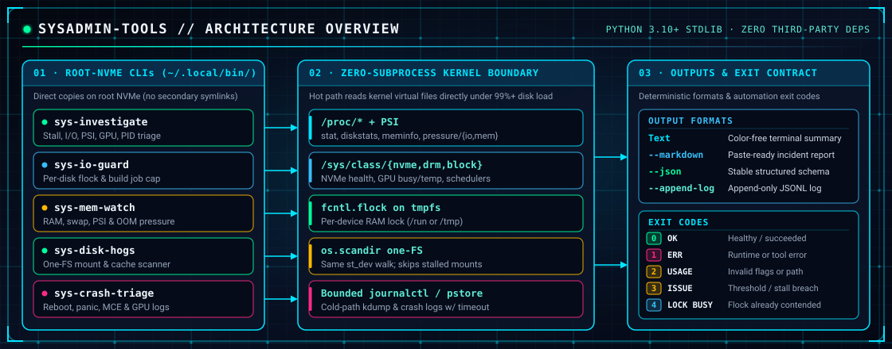

# Architecture & Subsystem Internals

[← Back to Documentation Hub](README.md)

## 1. System Architecture Overview



`sysadmin-tools` is architected as a **root-NVMe resident, zero-dependency diagnostic and guard plane** decoupled from the secondary storage and workload layers it monitors or serializes.

```mermaid
flowchart TD
    subgraph RootNVMe["Root NVMe (~/.local/bin — Direct Copies, Zero Symlinks)"]
        SI["sys-investigate"]
        SIG["sys-io-guard"]
        SMW["sys-mem-watch"]
        SDH["sys-disk-hogs"]
        SCT["sys-crash-triage"]
        SNW["sys-net-watch"]
        SSW["sys-systemd-watch"]
    end

    subgraph KernelFS["Kernel Virtual Filesystems (Zero Disk I/O)"]
        PROC["/proc (stat, diskstats, meminfo, vmstat, pressure, mounts, net/*, pid/*)"]
        SYS["/sys (nvme hwmon, thermal_zone, drm gpu_busy, block/dm-*/slaves, edac, fs/cgroup)"]
    end

    subgraph TmpfsLocks["Tmpfs / Runtime Lock Plane ($XDG_RUNTIME_DIR or /tmp)"]
        FLOCK["<lock_key>.lock (fcntl.flock) + <lock_key>.meta"]
    end

    subgraph HostLogs["Persistent Host Logs & Workspaces"]
        LOGS["/var/log/{kern.log,syslog}, pstore, /var/crash, kdump-tools, journal dirs/journald"]
        WORK["Workspaces & Secondary SSDs (/datanapps, Cargo target, node_modules)"]
    end

    subgraph Outputs["Deterministic Script-First Outputs"]
        OUT["stdout: Text / Markdown / JSON (sort_keys=True)"]
        JSONL["--append-log / --diff-log: Compact JSONL"]
        RC["Exit Codes: 0 / 1 / 2 / 3 / 4"]
    end

    SI --> PROC
    SI --> SYS
    SMW --> PROC
    SNW --> PROC
    SSW --> PROC
    SSW --> SYS
    SSW --> LOGS
    SIG --> PROC
    SIG --> SYS
    SIG --> FLOCK
    SDH --> PROC
    SDH --> WORK
    SCT --> PROC
    SCT --> SYS
    SCT --> LOGS

    SI --> OUT
    SMW --> OUT
    SDH --> OUT
    SCT --> OUT
    SIG --> OUT
    SNW --> OUT
    SSW --> OUT
    SI --> JSONL
    SMW --> JSONL
    SCT --> JSONL
    RootNVMe --> RC
```



## 2. Standalone Deployment Topology

A defining architectural constraint of `sysadmin-tools` is **isolation from degraded secondary disks**:

- **Source repository** may live anywhere (e.g., on a secondary SSD alongside Rust/Node build trees).
- **Installed executables** are copied verbatim (`install -m 0755`) by `scripts/install.sh` into `~/.local/bin` (on the root OS NVMe). Because every script in `src/sysadmin_tools/*.py` uses only Python 3.10+ stdlib modules and zero cross-module imports, each installed binary executes cleanly with no `PYTHONPATH` and no symlinks touching secondary mounts.
- **Lock coordination** (`sys-io-guard`) maps a target workspace path on a secondary SSD (e.g., `/datanapps/cargo-target` -> `nvme2n1`) to an advisory lock file stored on **tmpfs/root** (`$SYS_IO_GUARD_LOCK_DIR`, `$XDG_RUNTIME_DIR/sys-io-guard`, or `/tmp/sys-io-guard-<uid>`). Even if `/datanapps` hits 100% utilization and 1,300 ms `w_await`, lock acquisition, `--status` probes, and diagnostics remain instantaneous.

## 3. Two-Snapshot Delta Pipeline

`sys-investigate` and `sys-mem-watch` avoid point-in-time averages by capturing two snapshots separated by `--interval` seconds measured with `time.monotonic()`:

```mermaid
sequenceDiagram
    participant Op as Operator / Timer
    participant CLI as sys-investigate / sys-mem-watch
    participant Proc as /proc & /sys
    participant Clf as Deterministic Classifier

    Op->>CLI: Invoke (--interval 2.0, --json / --exit-on-issue)
    CLI->>Proc: Snapshot t0 (cpu/disk/vmstat + PID table; threads skipped)
    Note over CLI: time.sleep(interval)
    CLI->>Proc: Snapshot t1 (cpu/disk/vmstat + PID table + /task/*/wchan)
    CLI->>CLI: Compute exact dt = monotonic(t1) - monotonic(t0)
    CLI->>Proc: Bounded enrichment on top rows only (cgroup, readlink fds, NVMe hwmon)
    CLI->>Clf: Evaluate bottleneck, productivity / memory status, NVMe thermals
    Clf-->>CLI: Structured verdict (status, is_issue, reasons, recommendations)
    CLI-->>Op: stdout (Text / Markdown / JSON) + optional JSONL + exit code (0 or 3)
```

- **Snapshot `t0`** skips per-thread `/proc/<pid>/task/*` scanning to keep capture fast and minimize race windows.
- **Snapshot `t1`** collects thread states (`R` / `D`) and kernel `wchan` symbols, matches PIDs by `(pid, starttime)` to avoid PID-reuse corruption, and enriches only top-ranked rows with cgroup labels and mount attribution (`max_fds=128`).

## 4. Subsystem Deep-Dives

### 4.1 `sys-investigate` (`src/sysadmin_tools/sys_investigate.py`)
- **Telemetry sources:** `/proc/stat`, `/proc/loadavg`, `/proc/pressure/{cpu,io,memory}`, `/proc/meminfo`, `/proc/vmstat`, `/proc/diskstats`, `/proc/mounts`, `/proc/<pid>/{stat,cmdline,statm,io,status,oom_score,cgroup,cwd,fd/*,task/*}`, `/sys/class/drm/card*/device/gpu_busy_percent`, `/sys/class/nvme/nvme*/{model,state,hwmon*/temp*_*}`, `/sys/class/thermal/thermal_zone*/{type,temp}`.
- **Key capabilities:**
  - Whole physical disk filtering (`nvme0n1` vs `nvme0n1p1`; `sd*`/`vd*` partition exclusion) with mount-point mapping and safe `statvfs()` filtering.
  - Overlapping workload detector (`script:*`, `tool:cargo`, `tool:rust-lld`, `tool:rustc`) with process ancestry chains (`build_ancestry`).
  - Container/service attribution from `/proc/<pid>/cgroup` (`docker:`, `podman:`, `containerd:`, `systemd:`).
  - NVMe thermal monitoring (`NORMAL`, `WARM`, `CRITICAL`) directly from `/sys/class/nvme/nvme*/hwmon*`.
  - `--progress-check`: runs two consecutive sampling windows and invokes `compare_windows()` to distinguish transient spikes from confirmed stalls (`CONFIRMED_STALL`, `PERSISTENT_THRASH`, `RECOVERING`, `WORSENING`, `IDLE`, `STEADY_PROGRESS`).
  - `--diagnose-pid PID`: two-snapshot drill-down of a single target PID and its entire descendant process subtree (CPU, RSS, swap, OOM score, disk R/W vs `wchar`, thread states, D-state `wchan` breakdown).
  - `--diff-log PATH` (`--diff-baseline`, `--diff-window`): offline JSONL trend analyzer comparing early vs late halves, sliding `prior N` vs `last N` cohorts, or a baseline file vs target file (`STABLE_HEALTHY`, `RECOVERING`, `INTERMITTENT_ISSUES`, `PERSISTENT_ISSUE`, `DEGRADING`), skipping corrupt lines safely and surfacing recurring `D`-state / I/O / CPU offenders.

### 4.2 `sys-io-guard` (`src/sysadmin_tools/sys_io_guard.py`)
- **Device resolution:** Resolves `--path` (default `$CARGO_TARGET_DIR` or cwd) against `/proc/mounts` (longest mountpoint prefix), traverses `/sys/block/dm-*/slaves` for LVM/LUKS/device-mapper stacks to find the backing physical disk (`nvme2n1`, `sda`, `mmcblk0`), or falls back to `mnt-<sha1[:8]>` for virtual/network filesystems.
- **Locking & metadata:** Acquires an exclusive advisory `fcntl.flock()` on `<lock_dir>/<lock_key>.lock` (supporting blocking wait, `--timeout SEC`, or non-blocking `--timeout 0`), then atomically writes `<lock_dir>/<lock_key>.meta` (`pid`, `ppid`, `cmd`, `lock_key`, `target_path`, `started_at`).
- **Execution hygiene:** Sets `CARGO_BUILD_JOBS` (default `min(8, max(2, cpus // 4))`, `0` disables), applies optional child `os.nice(N)` via `preexec_fn`, merges repeatable `--env KEY=VAL` overrides, and runs `subprocess.run(cmd, ...)` without a shell. Handles `SIGTERM`/`SIGINT` cleanly and always releases the lock in `finally`.
- **Inspection modes:** `--status` probes every `*.lock` in the lock directory with `LOCK_EX | LOCK_NB` to report `ACTIVE` vs `IDLE` (and flags stale `.meta` files); `--dry-run` prints the full resolution plan without locking or executing.

### 4.3 `sys-mem-watch` (`src/sysadmin_tools/sys_mem_watch.py`)
- **Telemetry sources:** Pure `/proc` two-snapshot reads of `/proc/meminfo`, `/proc/vmstat` (`pswpin`, `pswpout`, `pgscan_direct*`, `pgscan_kswapd*`, `pgsteal_*`, `oom_kill`), `/proc/pressure/memory`, and `/proc/<pid>/{stat,cmdline,status,oom_score,oom_score_adj,cgroup}`.
- **Ranked views:** Computes exact RSS deltas (`rss_delta_mib`, `rss_rate_mibs`) and swap deltas across `[t0, t1]` and outputs four sorted leaderboards: `top_rss`, `top_growers` (`rss_delta_mib > 0`), `top_swap` (`swap_mib > 0`), and `top_oom_risk` (`oom_score`, `rss_mib`, `oom_score_adj`).
- **Bounded cgroup lookup:** `/proc/<pid>/cgroup` is parsed strictly for PIDs appearing in the four top-N leaderboards.

### 4.4 `sys-disk-hogs` (`src/sysadmin_tools/sys_disk_hogs.py`)
- **Traversal engine:** Iterative post-order DFS stack using `os.scandir()` (`follow_symlinks=False`), immune to Python recursion limits and symlink cycles.
- **Accounting accuracy:** Deduplicates multi-link files (`st_nlink > 1`) via a `(st_dev, st_ino)` set; enforces single-filesystem traversal per root by default (`st_dev == root_dev`, opt out with `--cross-mounts`); maintains a bounded min-heap (`heapq`) for `largest_files`.
- **Outer-hog rollup:** Once a directory matches a hog category (`classify_hog_dir`), descendant directories inherit `in_hog=True` so nested caches (e.g., `node_modules` inside a build dir) are never double-counted in `reclaimable_bytes`.
- **Reclaimable vs. VCS separation:** Classifies regenerable build/cache directories separately from `.git` (`vcs-metadata`, `reclaimable=False`), ensuring `.git` is never included in `reclaimable_bytes`.

### 4.5 `sys-crash-triage` (`src/sysadmin_tools/sys_crash_triage.py`)
- **Multi-source forensic correlation:**
  1. **Boot timeline & transition:** Parses `journalctl --list-boots` to compute previous-boot uptime, downtime gap, and kernel release changes (`Linux version ...`).
  2. **Hardware reset register decoding:** Extracts `x86/amd: Previous system reset reason [0x...]` from target boot kernel logs and decodes AMD FCH `S5_RESET_STATUS` (`0xFED803C0`) bitmasks (`thermal_trip`, `sync_flood`, `watchdog_timeout`, `cf9_full_reset`, `cf9_warm_reset`, `ac_power_loss`, `failed_boot_timer`, etc.).
  3. **Unclean shutdown & NUL-byte log boundary scanner:** Detects corrupted journals, EXT4/XFS/BTRFS journal recovery / orphan inode cleanup, and contiguous `\x00` byte runs in the trailing 8 MiB of `/var/log/kern.log` and `/var/log/syslog` left by interrupted buffered writes.
  4. **Signature engine with noise suppression:** Filters known benign noise (`audit: type=1326`, `qt.bluetooth.bluez`, `ring ... uses VM inv eng`) and classifies lines into `fatal` vs `context` buckets across `kernel_panic`, `mce_hardware`, `thermal`, `oom_killer`, `watchdog_lockup`, `gpu_fault`, and `storage_fault`.
  5. **Crash-capture readiness audit:** Inspects `/etc/default/kdump-tools` (`USE_KDUMP`) vs `/proc/cmdline` (`crashkernel=`), `/sys/fs/pstore`, `/var/lib/systemd/pstore`, `/var/crash`, `/sys/devices/system/edac/mc/mc*/{ce_count,ue_count}`, and `/var/log/unattended-upgrades/unattended-upgrades.log`.
- **Pure-file fallback:** `--no-journalctl` skips all `journalctl` subprocesses and relies solely on `/proc`, `/sys`, `/var/log/*`, pstore, and `/var/crash`.

### 4.6 `sys-net-watch` (`src/sysadmin_tools/sys_net_watch.py`)
- **Telemetry sources:** `/proc/net/dev`, `/proc/net/{tcp,tcp6}`, `/proc/net/{udp,udp6}`, `/proc/net/snmp`, `/proc/net/softnet_stat`.
- **Delta & queue engine:** Collects `--samples` snapshots spaced by `--interval` seconds (using 32-bit wrap-safe `_delta_u32` for `softnet_stat`), computes RX/TX `kbps`, `pps`, interface link/drop/collision deltas, SNMP TCP retransmit rate (`RetransSegs / OutSegs`), and inspects hex `tx_queue:rx_queue` pairs across all IPv4/IPv6 sockets alongside `CLOSE_WAIT` growth (`close_wait_delta`).

### 4.7 `sys-systemd-watch` (`src/sysadmin_tools/sys_systemd_watch.py`)
- **Telemetry sources:** `/sys/fs/cgroup` v2 (`memory.*`, `cpu.*`, `io.*`, `pids.*`, `cgroup.procs`), `/proc` (`uptime`, `<pid>/{stat,cgroup}`), and `/run/log/journal` + `/var/log/journal` metadata (`os.scandir()`).
- **Unit & churn engine:** Iteratively discovers `*.service`, `*.scope`, and `*.slice` directories (filtered via `--unit`), measures multi-snapshot memory OOM/PSI, CFS CPU throttling (`throttled_usec` / `nr_throttled`), I/O MB/s + PSI, process `D`/`Z` states, service crash-loop PID turnover (`full_pid_replacements` or rapid `+added/-exited`), and journal directory byte-growth bursts with zero `systemctl` or `journalctl` subprocesses.

## 5. Deterministic Verdict Rules

All classifiers enforce a strict invariant: whenever `is_issue` is `True`, at least one actionable recommendation is emitted and `"No immediate intervention needed."` is never returned.

### 5.1 `sys-investigate` (System Verdict)

| Dimension | Values | Trigger Rules |
| --- | --- | --- |
| **Saturated Disk (`sat_disks`)** | Per-device match | `util_pct >= 85%` OR `w_await_ms >= 50 ms` OR `aqu_sz >= 8.0` |
| **Bottleneck** | `MEMORY_SWAP_AND_IO_THRASH`, `MEMORY_SWAP_THRASH`, `MIXED_CPU_AND_IO`, `IO_WAIT_SATURATION`, `CPU_COMPUTE_BOUND`, `NORMAL_OR_IDLE` | `io_bound`: `wa >= 20%` OR `io_some10 >= 30%` OR `sat_disks` non-empty OR `d_state_total >= 16`. `mem_thrash`: `mem_some10 >= 20%` OR `swap_pages_delta >= 1000` OR `mem_avail_gib < 1.0`. `cpu_bound`: `us+sy+ni >= 70%` OR `cpu_some10 >= 30%`. |
| **Productivity** | `WEDGED_OR_STALLED`, `THRASHING_LOW_EFFICIENCY`, `SUSPECT_SPIN_LOOP`, `PRODUCTIVE_IO`, `PRODUCTIVE_COMPUTE`, `HEALTHY_IDLE_OR_LIGHT` | `thrashing`: `balance_dirty_pages >= 4` OR `dirty_gib >= 2.0` OR (`worst_util >= 90%` & `worst_w_await >= 100 ms`) OR (`worst_w_await >= 250 ms` & `worst_aqu >= 16.0`) OR `mem_thrash`. `making_progress`: `started > 0` OR `exited > 0` OR `total_disk_mbs >= 5.0`. `SUSPECT_SPIN_LOOP`: `>=95%` CPU, `0.0 MB/s` I/O, `elapsed >= 300s`, zero turnover. |
| **NVMe Thermal** | `CRITICAL`, `WARM`, `NORMAL` | `CRITICAL`: `alarm=True` OR `temp_c >= temp_crit_c` OR `state != "live"` (forces `is_issue=True`). `WARM`: `temp_c >= temp_max_c` OR `temp_c >= 70°C` (adds warning & recommendation). |
| **`is_issue`** | `True` / `False` | `productivity in {"THRASHING_LOW_EFFICIENCY", "WEDGED_OR_STALLED", "SUSPECT_SPIN_LOOP"}` OR any `CRITICAL` NVMe controller. |

### 5.2 `sys-investigate --diagnose-pid` (PID Verdict)

| Status | `is_issue` | Trigger Rule |
| --- | --- | --- |
| `BLOCKED_ON_IO` | `True` | `state == "D"` OR `d_threads > 0` OR `subtree_d_threads >= 2` |
| `MEMORY_HEAVY` | `True` | `swap_mib >= 512` OR (`oom_score >= 500` & `eff_rss_mib >= 1024`) OR `rss_pct >= 25%` OR `eff_rss_mib >= 8192` |
| `CPU_BOUND` | `True` if spinner, else `False` | `eff_cpu >= 80%` (flags `is_issue=True` if single-process `>=95%` CPU, `0.0 MB/s` I/O, `elapsed >= 300s`, 0 descendants) |
| `IO_ACTIVE` | `False` | `eff_io_mbs >= 1.0` OR `wchar_mbs >= 5.0` |
| `IDLE_OR_SLEEPING` | `False` | Default fallback |

### 5.3 `sys-mem-watch` (Memory Verdict, Priority Order)

| Priority | Status | `is_issue` | Trigger Rule |
| --- | --- | --- | --- |
| 1 | `OOM_IMMINENT` | `True` | `oom_kill_delta > 0` OR `mem_avail_gib < 0.5` OR (`mem_avail_pct < 5%` & `mem_avail_gib < 1.0`) OR (`psi_full10 >= 25%` & `mem_avail_pct < 10%`) OR (`mem_avail_pct < 8%` & `swap_used_pct >= 95%` & reclaim/PSI active) |
| 2 | `SWAP_THRASHING` | `True` | `swap_pages >= 1000` OR `swap_pages_per_sec >= 500` OR (`swap_pages >= 200` & (`psi_some10 >= 10%` OR `psi_full10 >= 5%` OR `pgscan_direct >= 500`)) |
| 3 | `RAPID_GROWTH_LEAK_RISK` | `True` | Any process with `rss_rate_mibs >= 50` & `rss_delta_mib >= 20`, OR combined top-grower rate `>= 100 MiB/s` & `>= 50 MiB` |
| 4 | `HIGH_MEMORY_PRESSURE` | `True` | `psi_some10 >= 10%` OR `psi_full10 >= 5%` OR `pgscan_direct >= 1000` OR (`pgscan_kswapd >= 10000` & `mem_avail_pct < 20%`) OR `mem_avail_pct < 15%` OR `mem_avail_gib < 2.0` |
| 5 | `HEALTHY` | `False` | None of the above |

### 5.4 `sys-crash-triage` (Post-Crash Verdict, Priority Order)

| Priority | Status | `is_issue` | Confidence | Trigger Rule |
| --- | --- | --- | --- | --- |
| 1 | `INSUFFICIENT_DATA` | `False` | `LOW` | No journal, log file, or AMD reset data readable |
| 2 | `KERNEL_PANIC_OR_OOPS` | `True` | `HIGH` | Fatal `kernel_panic` signature matched |
| 3 | `HARDWARE_MCE_OR_THERMAL` | `True` | `HIGH` | Fatal `mce_hardware` / `thermal` signature, EDAC `total_ue > 0`, or AMD reset `THERMAL_TRIP` / `SYNC_FLOOD_HW_FAULT` |
| 4 | `OOM_OR_LOCKUP_CRASH` | `True` | `HIGH` | Fatal `oom_killer` / `watchdog_lockup` signature, or AMD reset `WATCHDOG_RESET` |
| 5 | `GPU_OR_STORAGE_FAULT_RESET` | `True` | `HIGH` | `is_unclean=True` AND fatal `gpu_fault` or `storage_fault` matched |
| 6 | `UNCLEAN_HARD_RESET` | `True` | `MEDIUM` / `LOW` | `is_unclean=True` OR AMD reset `FAILED_BOOT_TIMER` / `POWER_LOSS_OR_BUTTON` (includes silent `CF9_FULL_RESET`) |
| 7 | `CLEAN_REBOOT` | `False` | `HIGH` / `MEDIUM` | No unclean or fatal crash indicators |

### 5.5 `sys-disk-hogs` (Directory Classification Categories)

| Category | Reclaimable | Matched Directory Names / Rules |
| --- | --- | --- |
| `rust-target` | Yes | `cargo-target`, or `target` with `Cargo.toml` in parent or Rust markers inside |
| `node-modules` | Yes | `node_modules` |
| `python-venv` | Yes | `.venv`, `venv`, `.tox`, `.nox` |
| `python-cache` | Yes | `__pycache__`, `.pytest_cache`, `.mypy_cache`, `.ruff_cache` |
| `build-artifacts` | Yes | `build`, `dist`, `.next`, `.nuxt`, `.turbo`, `.parcel-cache`, `.gradle`, `CMakeFiles` |
| `general-cache` | Yes | `.cache`, `.cargo`, `.npm`, `.pnpm-store`, `.yarn`, `go-build` |
| `vcs-metadata` | **No** | `.git` (tracked separately; excluded from `reclaimable_bytes`) |

### 5.6 `sys-net-watch` (Network Verdict, Priority Order)

| Priority | Status | `is_issue` | Trigger Rule |
| --- | --- | --- | --- |
| 1 | `LINK_ERRORS` | `True` | `link_errors_delta >= 1` OR `tx_colls_delta >= 10` OR `tcp_in_errs >= 5` OR `tcp_csum_errs >= 1` OR `udp_csum_errs >= 1` |
| 2 | `PACKET_DROPS` | `True` | `iface_drops_delta >= 5` OR `softnet_drops >= 1` OR `softnet_time_squeeze >= 50` OR `udp_buf_errs >= 1` OR `udp_in_errs >= 5` OR `udp_mem_errs >= 1` |
| 3 | `ELEVATED_RETRANSMITS` | `True` | (`retrans >= 5` & `retrans_rate >= 1.0%`) OR `retrans >= 50` OR `estab_resets >= 20` OR `attempt_fails >= 20` |
| 4 | `SOCKET_PRESSURE` | `True` | `CLOSE_WAIT >= 50` (or `>= 20` & delta `>= 10`) OR `TIME_WAIT >= 2000` OR `SYN_RECV/SENT >= 100` OR `FIN_WAIT1/2+LAST_ACK >= 500` OR `udp_queue >= 256 KiB` / `>= 20` sockets OR `tcp_queue >= 16 MiB` |
| 5 | `HEALTHY` | `False` | None of the above |

### 5.7 `sys-systemd-watch` (Cgroup Verdict, Priority Order)

| Priority | Status | `is_issue` | Trigger Rule |
| --- | --- | --- | --- |
| 1 | `MEMORY_PRESSURE` | `True` | `oom`/`oom_kill` events > 0, `max` delta > 0, `high` delta >= 5, `memory.pressure` `full10 >= 5%` / `some10 >= 15%`, or `memory.current >= 95%` of `memory.max` |
| 2 | `CRASH_LOOP_SUSPECTED` | `True` | `*.service` unit with `full_pid_replacements >= 1`, rapid churn (`+>=2 / ->=2`), or newly restarted young PIDs (`max_age <= 3s`) with exit/zombie/OOM |
| 3 | `IO_PRESSURE` | `True` | `io.pressure` `full10 >= 10%` / `some10 >= 25%`, large PSI delta, or `d_state_pids >= 4` with active I/O / PSI |
| 4 | `CPU_THROTTLING` | `True` | `throttled_pct >= 10%`, `d_throttled >= 3` & ratio `>= 20%`, `cpu.pressure` `some10 >= 25%` / `full10 >= 10%`, or sustained lifetime throttling |
| 5 | `JOURNAL_BURST` | `True` | Journal directory growth `>= 1.0 MiB/s` AND `>= 512 KiB` in window |
| 6 | `HEALTHY` | `False` | None of the above |

## 6. JSON & JSONL Schema Conventions

All JSON-capable CLIs emit deterministic output (`json.dumps(..., sort_keys=True)`) with ISO-8601 local timestamps (`timestamp`) and rounded numeric metrics. `--append-log PATH` writes one compact JSON line per sample (`separators=(",", ":")` on `sys-investigate`/`sys-mem-watch`, single-line JSON on `sys-crash-triage`) and creates parent directories automatically.

| CLI / Mode | Top-Level JSON Keys |
| --- | --- |
| `sys-investigate` (default) | `cpu_pct`, `d_state_top`, `d_state_wchans`, `disks`, `gpus`, `load`, `memory`, `nvme_health`, `overlapping_workloads`, `psi`, `sample_sec`, `thermal_zones`, `timestamp`, `top_cpu`, `top_io`, `turnover`, `verdict` (+ `progress_check` when `--progress-check` is set) |
| `sys-investigate --diagnose-pid` | `mode` (`"pid"`), `sample_sec`, `subtree`, `target`, `threads`, `timestamp`, `verdict` |
| `sys-investigate --diff-log` | `baseline_path`, `baseline_summary`, `comparison_mode`, `earliest_vs_latest`, `log_path`, `mode` (`"diff_log"`), `recurring_offenders`, `summary`, `verdict`, `version`, `window_diff`, `window_requested` |
| `sys-io-guard --status --json` | `active_count`, `idle_count`, `lock_dir`, `locks` (array of `{active, holder, lock_file, lock_key, meta_file, stale_meta, state}`) |
| `sys-io-guard --dry-run --json` | `cargo_jobs`, `command`, `device`, `disk`, `env_overrides`, `fstype`, `lock_dir`, `lock_file`, `lock_key`, `lock_key_source`, `meta_file`, `mountpoint`, `nice`, `target_path`, `timeout` |
| `sys-mem-watch` | `memory`, `psi`, `sample_sec`, `timestamp`, `top_growers`, `top_oom_risk`, `top_rss`, `top_swap`, `turnover`, `verdict` |
| `sys-disk-hogs` | `largest_files`, `options`, `reclaimable_hogs`, `summary`, `timestamp`, `top_dirs`, `vcs_metadata` |
| `sys-crash-triage` | `boots_history`, `crash_capture`, `hardware_reset`, `manual_steps`, `nul_log_scans`, `previous_boot_tail`, `signatures`, `system`, `target_boot_index`, `timestamp`, `transition`, `unclean_evidence`, `verdict`, `warnings` |
| `sys-net-watch` | `iface_filter`, `interfaces`, `interfaces_summary`, `sample_sec`, `samples`, `snmp`, `sockets`, `softnet`, `timestamp`, `verdict`, `version` |
| `sys-systemd-watch` | `cgroup_root`, `journal`, `problem_units`, `sample_sec`, `samples`, `summary`, `timestamp`, `top_cpu`, `top_io`, `top_memory`, `top_slices`, `unit_filter`, `verdict`, `version` |

---

[← Previous: Purpose & Principles](purpose.md) | [Next: Installation & CLI Reference →](running.md)
