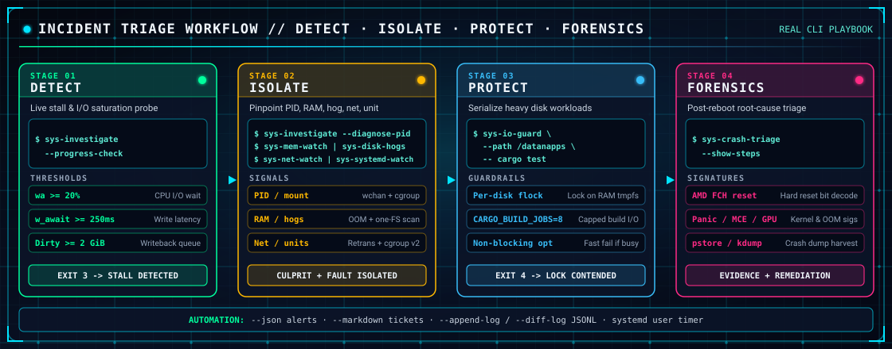

# How-To Recipes & Troubleshooting

[← Back to Documentation Hub](README.md)

## Incident Triage Workflow



---

## Recipe 1: Diagnose I/O Saturation vs. CPU Spin Loop

When load average spikes or the desktop/shell becomes sluggish, run a two-second investigation without triggering blocking `statvfs()` calls:

```bash
# 1. Fast, mount-safe triage
sys-investigate --no-statvfs

# 2. Confirm whether a high-load state is progressing or truly wedged (2 consecutive windows)
sys-investigate --progress-check --interval 2 --no-statvfs

# 3. Extract the verdict and saturated disks via jq
sys-investigate --json --no-statvfs | jq '{verdict: .verdict, d_wchans: .d_state_wchans, disks: [.disks[] | select(.util_pct >= 85)]}'

# 4. Drill into a specific suspicious PID and its descendant subtree
sys-investigate --diagnose-pid 12345 --interval 2 --no-statvfs
```

**How to interpret:**
- `IO_WAIT_SATURATION` + `THRASHING_LOW_EFFICIENCY` + `balance_dirty_pages` in `d_state_wchans` -> SSD writeback collapse (serialize builds with `sys-io-guard`).
- `CPU_COMPUTE_BOUND` + `SUSPECT_SPIN_LOOP` -> long-running `>=95%` CPU task with `0.0 MB/s` I/O (inspect with `--diagnose-pid PID`).
- `NVMe critical thermal/health alert` -> check drive cooling and SMART/dmesg immediately.

---

## Recipe 2: Serialize Concurrent Cargo / Build Runs with `sys-io-guard`

Prevent overlapping builds or test suites from exhausting the same SSD's SLC write cache:

```bash
# 1. Dry-run to verify which physical disk and lock file will be used
sys-io-guard --dry-run --path /datanapps/cargo-target -- cargo test

# 2. Wrap builds/tests so only one heavy writer runs per physical SSD at a time
sys-io-guard --path /datanapps/cargo-target --cargo-jobs 4 --nice 12 -- bash scripts/verify.sh

# 3. Fail fast (exit 4) if another build already holds the disk lock for > 30s
sys-io-guard --timeout 30 -- cargo build --release

# 4. Inspect active and idle locks from another terminal
sys-io-guard --status
sys-io-guard --status --json | jq '.locks[] | select(.active)'
```

**Tip:** If `CARGO_TARGET_DIR` is exported in your shell, you can omit `--path` — `sys-io-guard` automatically resolves `$CARGO_TARGET_DIR` to its backing physical disk (`nvme2n1`, `sda`, etc.) and places the lock on tmpfs (`$XDG_RUNTIME_DIR/sys-io-guard`).

---

## Recipe 3: Hunt Memory Leaks & OOM Risk with `sys-mem-watch`

Catch runaway heap allocations or swap thrashing before the kernel OOM killer fires:

```bash
# 1. Single 3-second delta snapshot showing top RSS, fastest growers, swap users, and OOM risk
sys-mem-watch --interval 3 --top 15

# 2. Continuously watch for 10 samples and persist JSONL telemetry for post-mortem trending
sys-mem-watch --watch 10 --interval 2 --append-log /var/tmp/sys-mem-watch.jsonl

# 3. Gate an automated healthcheck script (exits 3 on HIGH_MEMORY_PRESSURE / LEAK_RISK / SWAP_THRASHING / OOM_IMMINENT)
sys-mem-watch --exit-on-issue --json > /tmp/mem-check.json || echo "Memory issue detected (rc=$?)"
```

---

## Recipe 4: Reclaim Workspace Disk Space with `sys-disk-hogs`

Locate regenerable build directories (`target/`, `node_modules/`, `.venv/`, caches) separately from non-reclaimable `.git` metadata without spawning `du` or crossing mount points:

```bash
# 1. Scan home and secondary data workspace on their own filesystems
sys-disk-hogs ~ /datanapps --top 20 --depth 3

# 2. List only reclaimable hogs >= 50 MiB in JSON for scripted review
sys-disk-hogs /datanapps --min-mib 50 --min-file-mib 100 --json \
  | jq '.reclaimable_hogs[] | {gib: .size_gib, category: .category, path: .path}'

# 3. Mount-safe Markdown report for a cleanup ticket (skips statvfs)
sys-disk-hogs . --no-statvfs --markdown
```

**Safety guarantee:** `sys-disk-hogs` is strictly **read-only** — it never deletes files, deduplicates hardlinks by `(st_dev, st_ino)`, and separates `.git` (`vcs-metadata`) from `reclaimable_bytes`.

---

## Recipe 5: Run Post-Crash & Unexpected-Reboot Triage with `sys-crash-triage`

After a sudden reboot or hard freeze, automatically correlate boot gaps, AMD FCH reset registers (`0xCF9=0xE`, thermal trip, sync flood, watchdog), NUL-byte log boundaries, crash signatures, and `kdump`/pstore readiness:

```bash
# 1. Full triage of the current boot (after crash) plus copy-pasteable manual follow-up commands
sys-crash-triage --show-steps

# 2. Inspect an earlier reboot (-1) with a 10-boot timeline and 200-line previous-boot tail
sys-crash-triage --boot -1 --boots-history 10 --tail-lines 200

# 3. Pure-file mode (skip journalctl entirely; read /proc, /sys, /var/log/*, pstore, /var/crash only)
sys-crash-triage --no-journalctl --json | jq '.verdict'

# 4. Generate a Markdown post-mortem summary and exit 3 if an unclean crash occurred
sys-crash-triage --markdown --append-log /var/tmp/crash-triage.jsonl --exit-on-issue
```

---

## Recipe 6: Set Up a User `systemd` Timer + JSONL Telemetry & `--diff-log`

Record periodic diagnostic snapshots on root storage so you always have pre-stall evidence when a spike occurs — and diff trends offline with `sys-investigate --diff-log`.

Install the packaged templates from [`packaging/systemd/`](../packaging/systemd/README.md):

```bash
mkdir -p ~/.config/systemd/user
cp packaging/systemd/sys-investigate-sampler.service ~/.config/systemd/user/
cp packaging/systemd/sys-investigate-sampler.timer ~/.config/systemd/user/
systemctl --user daemon-reload
systemctl --user enable --now sys-investigate-sampler.timer
systemctl --user list-timers sys-investigate-sampler.timer
```

Query and trend-diff recorded telemetry:

```bash
# List only logged incidents where verdict.is_issue == true
jq -c 'select(.verdict.is_issue) | {ts: .timestamp, bottleneck: .verdict.bottleneck, prod: .verdict.productivity, reasons: .verdict.reasons}' \
  ~/.local/state/sysadmin-tools/investigate.jsonl

# Summarize trends across the log (early half vs late half, or last N vs prior N)
sys-investigate --diff-log ~/.local/state/sysadmin-tools/investigate.jsonl
sys-investigate --diff-log ~/.local/state/sysadmin-tools/investigate.jsonl --diff-window 5 --exit-on-issue

# Compare an incident log against a healthy baseline log
sys-investigate --diff-log after.jsonl --diff-baseline before.jsonl --json | jq '.verdict'
```

---

## Recipe 7: Triage Network Drops & Systemd Cgroup Pressure

Isolate NIC/softnet/socket issues or misbehaving systemd services without spawning `ss`, `ethtool`, `systemctl`, or `journalctl`:

```bash
# 1. Inspect NIC link errors, packet drops, TCP retransmits, CLOSE_WAIT growth, and softnet drops
sys-net-watch --interval 1 --samples 2 --top 8
sys-net-watch --iface eno1 --exit-on-issue --json | jq '.verdict'

# 2. Inspect systemd cgroup v2 memory/OOM pressure, CPU throttling, crash-loops, and journal bursts
sys-systemd-watch --interval 1 --samples 2 --top 10
sys-systemd-watch --unit docker --exit-on-issue --markdown
```

---

## Recipe 8: Run Local CI Verification (`scripts/verify.sh` & `.github/workflows/ci.yml`)

Run the same zero-dependency verification suite locally that runs in [`.github/workflows/ci.yml`](../.github/workflows/ci.yml):

```bash
# Full 3-stage verification: syntax (py_compile) + unit (143 tests) + smoke (23 tests) = 166 tests
./scripts/verify.sh

# Fast inner loop (syntax + unit tests only)
./scripts/verify.sh --quick

# Filter tests by pattern (unittest -k)
./scripts/verify.sh --tier unit --match net_watch

# Inspect generated verification report and verify installer dry-run
cat target/verify/report.md
./scripts/install.sh --dry-run
```

---

## Troubleshooting Matrix

| Symptom | Likely Cause | Resolution |
| --- | --- | --- |
| `sys-investigate` shows `-` or omits disk MB/s for `root` daemons | Unprivileged user cannot read `/proc/<pid>/io` of other UIDs | Expected fail-open behavior; re-run with `sudo sys-investigate` when attributing root-owned processes |
| `sys-investigate` or `sys-disk-hogs` hangs before printing output | Blocked `os.statvfs()` on a wedged local/custom mount | Pass `--no-statvfs` to bypass all `statvfs()` calls |
| `sys-io-guard` exits with code `4` | Another process holds the exclusive `flock` for that physical disk past `--timeout` | Run `sys-io-guard --status` to inspect holder PID/cmdline, wait for completion, or increase `--timeout` |
| `sys-io-guard --status` shows `[IDLE] ... (stale .meta present)` | Previous holder crashed or was `SIGKILL`ed before cleanup | Safe to ignore — kernel already released `fcntl.flock`; the next lock holder atomically overwrites `.meta` |
| `sys-io-guard --json` exits with code `1` | `--json` was passed in normal command-execution mode | `--json` is only valid with `--status` or `--dry-run` on `sys-io-guard` |
| `sys-crash-triage` returns `INSUFFICIENT_DATA` or warnings about `journalctl` | Current user lacks `adm` / `systemd-journal` group membership or `journalctl` timed out | Add user to `adm`/`systemd-journal` (or run with `sudo`), raise `--journal-timeout`, or use `--no-journalctl` |
| `sys-crash-triage` warns `MISCONFIGURED: RAM reserved but USE_KDUMP=0` | `crashkernel=` is set in `/proc/cmdline` but `/etc/default/kdump-tools` disables kdump | Set `USE_KDUMP=1` in `/etc/default/kdump-tools` and run `sudo systemctl restart kdump-tools` |
| Installed CLI in `~/.local/bin` behaves differently than repo `src/` | Direct copies were installed before recent edits | Re-run `./scripts/install.sh` to refresh `~/.local/bin/*` copies |

---

[← Previous: Installation & CLI Reference](running.md) | [Back to Documentation Hub](README.md)
