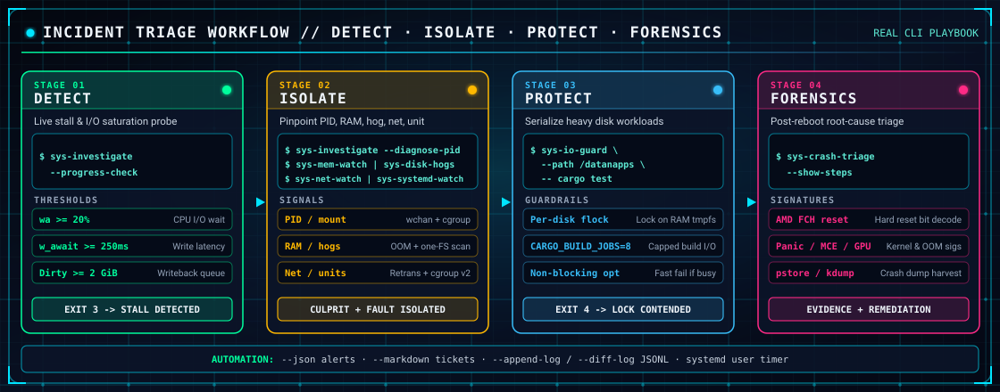
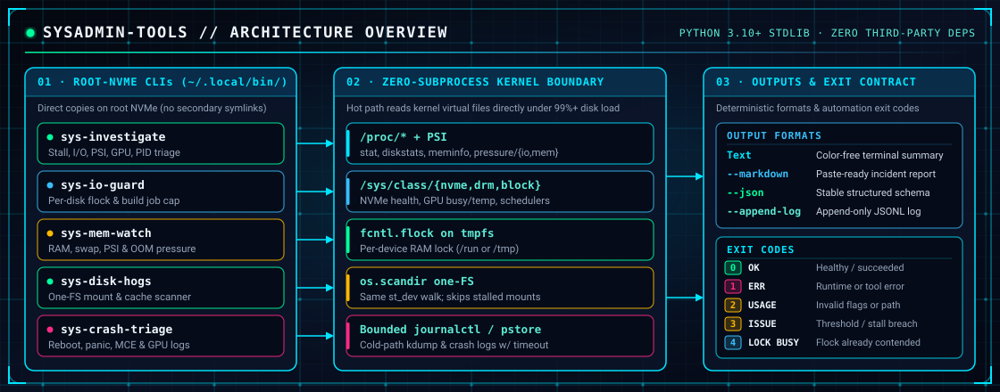

[← Back to Project README](../../README.md)

# sysadmin-tools User's Guide (v0.5.0)

Welcome to the operator manual for **sysadmin-tools** — seven zero-dependency, standalone Linux diagnostic and workload-guard CLIs written in Python 3.10+ stdlib only. Every hot-path diagnostic reads `/proc` and `/sys` directly without shelling out, and every binary installs as an independent copy on your root filesystem so diagnostics keep working even when secondary NVMe or data mounts are 99%+ saturated.

---

## Table of Contents

| Chapter | Topic | Primary Tools |
|---|---|---|
| [Chapter 1: Getting Started](01-getting-started.md) | Prerequisites, root-NVMe installation, 166-test local verification, and a first-run tour of all 7 CLIs | `install.sh`, `verify.sh`, all 7 CLIs |
| [Chapter 2: Live System Investigation](02-live-system-investigation.md) | Diagnosing load spikes, `D`-state threads, disk/NVMe thermal stalls, mount & cgroup attribution, `--progress-check`, `--diagnose-pid`, and offline `--diff-log` trending | `sys-investigate` |
| [Chapter 3: Preventing I/O Storms](03-preventing-io-storms.md) | Serializing heavy Rust/C++ builds per physical disk via tmpfs `flock`, Cargo job caps, `nice` throttling, `--dry-run`, and `--status` | `sys-io-guard` |
| [Chapter 4: Memory & Disk Auditing](04-memory-and-disk-auditing.md) | Tracking RSS/swap growth, reclaim pressure, and OOM risk; auditing workspace disk hogs and reclaimable caches safely | `sys-mem-watch`, `sys-disk-hogs` |
| [Chapter 5: Post-Crash Forensics](05-post-crash-forensics.md) | Investigating unexpected reboots, AMD FCH `S5_RESET_STATUS` registers, NUL-byte log gaps, crash signatures, and `kdump`/`pstore` readiness | `sys-crash-triage` |
| [Chapter 6: Automation & Troubleshooting](06-automation-and-troubleshooting.md) | `jq` pipelines, exit-code alerting, JSONL telemetry + `packaging/systemd/` timers, CI verification, and a practical FAQ | All 7 CLIs |
| [Chapter 7: Network & Systemd Cgroup Watch](07-network-and-systemd-watch.md) | Pure `/proc/net/*` NIC/TCP/UDP/SNMP/softnet diagnostics and zero-subprocess `/sys/fs/cgroup` v2 unit pressure, crash-loop, and journal burst monitoring | `sys-net-watch`, `sys-systemd-watch` |

---

## Which Tool Should I Run Right Now?

| Symptom / Operational Goal | Run This Command First | What You Will Learn |
|---|---|---|
| **Load average is spiking, desktop/shell feels sluggish, or disk LED is solid** | `sys-investigate --progress-check --interval 2` | Separates CPU compute vs I/O wait vs swap thrash, lists `D`-state wait channels (`balance_dirty_pages`, etc.), NVMe thermals, and confirms whether work is progressing or wedged. |
| **A single service, build, or PID looks stuck or hot** | `sys-investigate --diagnose-pid <PID> --interval 2` | Shows per-thread `R`/`D`/`S` breakdown, kernel `wchan`, active mounts, cgroup, and aggregated CPU/RSS/I/O across the entire descendant subtree. |
| **Secondary mount is hung (NFS/FUSE/stalled SSD) and normal commands freeze** | `sys-investigate --no-statvfs --interval 2` | Skips `os.statvfs()` completely and reads only kernel virtual files in `/proc` and `/sys`. |
| **Compare recorded `--append-log` JSONL snapshots for degradation or spikes** | `sys-investigate --diff-log ~/.local/state/sysadmin-tools/investigate.jsonl --diff-window 5` | Classifies trend (`STABLE_HEALTHY`, `RECOVERING`, `DEGRADING`, `PERSISTENT_ISSUE`), computes cohort deltas, and surfaces recurring offenders offline. |
| **Multiple `cargo test`, `verify.sh`, or C++ linkers are fighting over the same SSD** | `sys-io-guard --path /datanapps/cargo-target -- cargo test` | Serializes builds per backing physical disk using tmpfs `flock`, caps `CARGO_BUILD_JOBS`, and lowers CPU priority (`--nice`). |
| **Check whether a guarded build is currently holding a disk lock** | `sys-io-guard --status` | Probes `*.lock` files non-blockingly and prints holder PID, PPID, start timestamp, target path, and command. |
| **RAM is disappearing, swap is active, or a process might be leaking memory** | `sys-mem-watch --interval 2 --top 15` | Ranks top RSS, fastest RSS growers (`MiB/s`), swap consumers, and `oom_score` targets alongside memory PSI and `pgscan_direct`. |
| **A workspace or SSD is filling up and you need safe space back** | `sys-disk-hogs ~/src /datanapps --top 20 --depth 2` | Finds largest directories/files and separates reclaimable build/cache hogs (`target/`, `node_modules/`, `.venv/`) from non-reclaimable `.git` history. |
| **The machine just rebooted unexpectedly or hard-locked** | `sys-crash-triage --show-steps` | Builds boot downtime timeline, decodes AMD `S5_RESET_STATUS` (`0xCF9`, `sync_flood`, `thermal_trip`, etc.), detects NUL-byte log gaps and crash signatures, and audits `kdump`/`pstore`. |
| **Network feels lossy, TCP connections stall, or `CLOSE_WAIT` / softnet drops grow** | `sys-net-watch --interval 1 --samples 2` | Measures NIC link/drop deltas, IPv4/IPv6 TCP & UDP socket state/queue pressure, SNMP retransmit rates, and per-CPU `softnet_stat` drops. |
| **A systemd service is OOMing, CFS-throttled, crash-looping, or flooding journald** | `sys-systemd-watch --interval 1 --samples 2` | Monitors `/sys/fs/cgroup` v2 memory/CPU/IO pressure, rapid PID churn (`*.service`), and journal directory byte-growth bursts with zero `systemctl` calls. |
| **Need machine-readable telemetry for alerting or cron/systemd timers** | `<tool> --exit-on-issue --json` | Emits deterministic JSON (`sort_keys=True`) and exits `3` on detected issues (with `--append-log` JSONL on `sys-investigate`, `sys-mem-watch`, `sys-crash-triage`). |

---

## System Architecture at a Glance

For deeper engineering contracts, design invariants, and origin-incident notes, see:
- [Running & CLI Reference](../running.md)
- [As-Built Buildspec](../BUILDSPEC.md)
- [Engineering Notes & Incident Journal](../NOTES.md)

---

**Navigation:** [Next: Chapter 1 — Getting Started →](01-getting-started.md)
